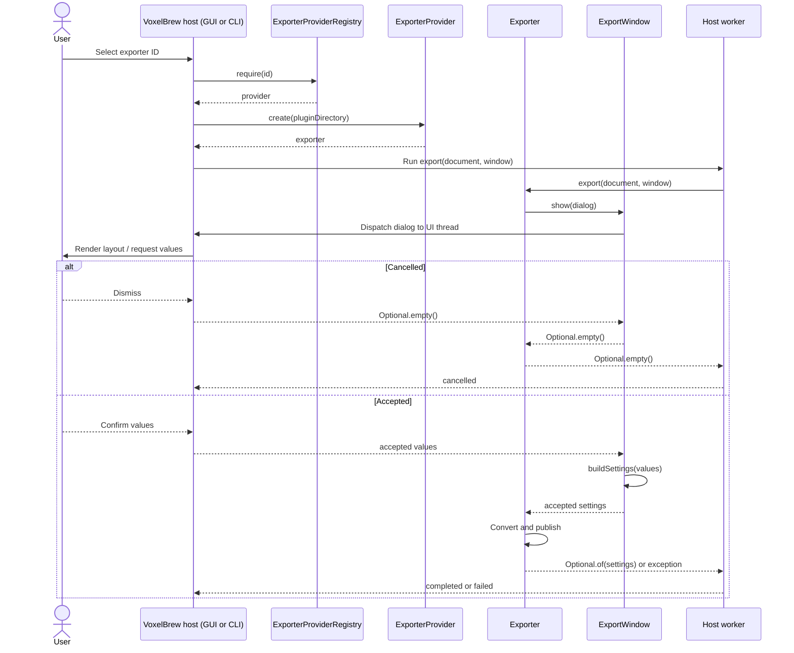

# VoxelBrew Export API

The Export API lets you add an exporter to VoxelBrew without building it into the
application. An exporter can write a local file, publish to a service, or use another
destination. The desktop application and CLI discover exporter providers from JARs and
collect their settings through the same frontend-neutral contract.

This repository contains the public API, licensed under [MIT](LICENSE). You can develop
and distribute an exporter separately, including as a private plugin. The VoxelBrew
application is [separately licensed under AGPL-3.0](https://github.com/Voxel-Brew/VoxelBrew/blob/master/LICENSE);
that license does not apply to this API repository.

## How it works

An `ExporterProvider<T>` gives the host an `ExporterDescriptor` with a stable ID,
display name, and implementation version for the GUI and CLI. It creates an
`Exporter<T>`. The exporter receives a `CadDocument` and an `ExportWindow`. It asks
the window to show an `ExportDialog<T>`, performs the export, then returns
`Optional<T>` containing the accepted settings. Dismissing the dialog returns
`Optional.empty()`; conversion and publication failures may be thrown as checked
exceptions to the caller.
The host chooses a worker thread for GUI exports and arranges for dialogs to appear
on the UI thread. The CLI can call the exporter directly.

The dialog describes its controls with `VerticalLayout`, `HorizontalLayout`, and input
components such as `CheckBox` and `FileDestination`. The host renders them in JavaFX or
resolves them from CLI arguments. The exporter owns conversion, destination validation,
and publication.

### Provider discovery and export flow

## Start developing

Use Java 21 and depend on the published `dev.voxelbrew.api:export` artifact. Register
your provider class in
`META-INF/services/dev.voxelbrew.api.exporter.ExporterProvider`, then package that
resource with your implementation JAR. Keep VoxelBrew API classes out of the plugin JAR;
the host provides them at runtime.

See the [developer guide](doc/DEV_README.md) for a provider based on the text-file
example, dialog inputs, export execution, CLI usage, packaging, and validation.

## License

The Export API is licensed under the [MIT License](LICENSE).
