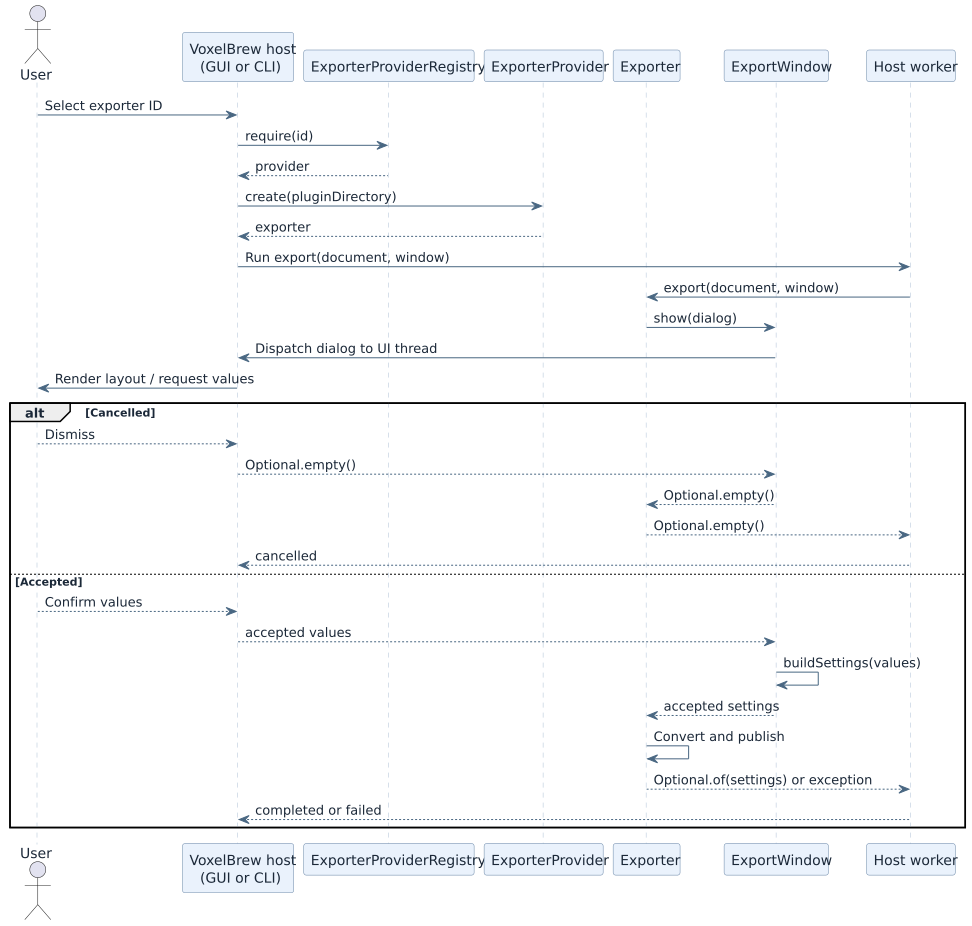

# Develop a VoxelBrew exporter

This guide builds a text-file example with `TextFileExporterProvider`,
`TextFileExporter`, `TextFileExportDialog`, and `TextFileExportSettings`. The example
writes a text report containing selected document information. You can use the same
public API for other file formats or remote destinations.

The public types are in `dev.voxelbrew.api.exporter` and
`dev.voxelbrew.api.model.vui`. The API stays independent of JavaFX, the CLI,
and VoxelBrew's native geometry engine. The Java excerpts below omit imports and
package declarations for brevity.



## 1. Add the API dependency

Use Java 21. For a released version from Maven Central, a minimal Gradle setup is:

```kotlin
plugins { `java-library` }

repositories { mavenCentral() }

dependencies {
    compileOnly("dev.voxelbrew.api:export:<version>")
}
```

Replace `<version>` with a [published version](https://central.sonatype.com/artifact/dev.voxelbrew.api/export).
`compileOnly` keeps the API out of your plugin JAR; VoxelBrew supplies it at runtime.
The export API exposes `CadDocument` through the Model API, so its public dependency
also supplies the model types at compile time. For snapshots, use the matching
VoxelBrew BOM and the GitHub Packages repositories configured in this repository's
`gradle/repositories.gradle.kts`.

## 2. Describe your exporter

Implement `ExporterProvider<T>`, where `T` is the settings type returned by your
dialog. The descriptor ID is the stable programmatic name used by the CLI. It must
match `[a-z0-9][a-z0-9.-]*` and be distinct from other exporters.

```java
public final class TextFileExporterProvider implements ExporterProvider<TextFileExportSettings> {
    public TextFileExporterProvider() {}

    @Override
    public ExporterDescriptor descriptor() {
        return new ExporterDescriptor("txt", "Text file exporter", "1.0.0");
    }

    @Override
    public Exporter<TextFileExportSettings> create() {
        return new TextFileExporter();
    }
}
```

The provider needs a public no-argument constructor for `ServiceLoader`. Keep
`descriptor()` and `create()` lightweight. Put your plugin's own version in the
descriptor; the GUI and CLI show it alongside the exporter name when it differs
from the application's version. If document evaluation needs custom feature
providers, arrange their discovery through your implementation or host integration;
`ExportWindow` only resolves dialogs and does not expose plugin directories.

## 3. Define settings and the dialog

The text-file example uses a record containing three booleans and the output path:

```java
public record TextFileExportSettings(
        boolean id, boolean bodyNames, boolean featureNames, Path path) {}
```

Implement every method of `ExportDialog<T>`. `layout()` builds a tree of components;
only inputs have IDs. `validate()` returns all input errors keyed by those IDs.
The host uses the errors beside controls in the GUI or in CLI prompts and argument
diagnostics. `buildSettings()` converts accepted string values into `T` and should
also reject invalid values when called directly.

`validate()` receives the current input values as strings. The map may be incomplete
while the CLI gathers answers, so treat absent values as missing or apply the same
defaults used by `buildSettings()`. Check every field in one call and return an empty
map when the settings are valid. Use each input component's `id()` as the error key;
the message should tell the user how to correct that field. Keep validation free of
side effects because the host may call it repeatedly as values change. Validation
of document state, destination existence, overwrite consent, and publication must
still happen during export, when those conditions can be checked reliably.

```java
public final class TextFileExportDialog implements ExportDialog<TextFileExportSettings> {
    private final CheckBox idInput = new CheckBox("cad.id", "Include CAD ID", true);
    private final CheckBox bodyNamesInput = new CheckBox("cad.bodyNames", "Include Body Names", true);
    private final CheckBox featureNamesInput = new CheckBox("cad.featureNames", "Include Feature Names", true);
    private final FileDestination destinationInput = new FileDestination("destination", "txt");

    @Override
    public String title() {
        return "Text File Exporter";
    }

    @Override
    public Layout layout() {
        return new VerticalLayout(idInput, bodyNamesInput, featureNamesInput, destinationInput);
    }

    @Override
    public Map<String, String> validate(Map<String, String> values) {
        var errors = new LinkedHashMap<String, String>();
        String destination = values.get(destinationInput.id());
        if (destination == null || destination.isBlank())
            errors.put(destinationInput.id(), "Choose a destination");
        else {
            try {
                Path.of(destination);
            } catch (InvalidPathException failure) {
                errors.put(destinationInput.id(), "Invalid destination path");
            }
        }
        for (CheckBox input : List.of(idInput, bodyNamesInput, featureNamesInput)) {
            String value = values.getOrDefault(input.id(), Boolean.toString(input.selected()));
            if (!"true".equals(value) && !"false".equals(value))
                errors.put(input.id(), "Choose true or false");
        }
        return errors;
    }

    @Override
    public TextFileExportSettings buildSettings(Map<String, String> values) {
        var errors = validate(values);
        if (!errors.isEmpty()) throw new IllegalArgumentException(String.join("; ", errors.values()));
        String destination = values.get(destinationInput.id());
        return new TextFileExportSettings(
                booleanValue(values, idInput),
                booleanValue(values, bodyNamesInput),
                booleanValue(values, featureNamesInput),
                Path.of(destination));
    }

    private static boolean booleanValue(Map<String, String> values, CheckBox input) {
        return switch (values.getOrDefault(input.id(), Boolean.toString(input.selected()))) {
            case "true" -> true;
            case "false" -> false;
            default -> throw new IllegalArgumentException("Invalid value for " + input.id());
        };
    }
}
```

Use unique input IDs within a dialog. `HorizontalLayout` and `VerticalLayout` can be
nested. Keep inputs as fields when their IDs or defaults are also needed by
`validate()` and `buildSettings()`, as in the example above. Available input components
include `TextField`, `TextArea`, `CheckBox`, `ComboBox`, `RadioButtonGroup`, `Slider`,
and `FileDestination`; `Label` and `Separator` are display-only.
`FileDestination` also accepts an optional third `Path defaultPath` argument. If it
is absent, the desktop app suggests the configured default save folder plus the
current project name; the CLI asks for the path unless one was supplied by an option.

For a file export that only needs a destination and overwrite consent, use the
built-in `FileExportDialog` instead of defining a custom dialog and settings type:

```java
public final class SimpleFileExporter implements Exporter<FileExportDialog.Destination> {
    @Override
    public Optional<FileExportDialog.Destination> export(CadDocument document, ExportWindow window)
            throws IOException {
        var selected = window.show(new FileExportDialog("Export report", "txt"));
        if (selected.isEmpty()) return Optional.empty();
        var destination = selected.get();
        writeReport(document, destination.path(), destination.overwrite());
        return selected;
    }

    private void writeReport(CadDocument document, Path path, boolean overwrite) throws IOException {
        // Validate and publish the report safely, honoring overwrite consent.
        throw new UnsupportedOperationException("Implement publication");
    }
}
```

In the GUI, this shows a destination field with a Browse button that opens the
file picker, plus an Overwrite checkbox. The CLI accepts the same inputs as
`--export.<descriptor-id>.destination` and `--export.<descriptor-id>.overwrite`.
The extension argument (`"txt"` above) is used for the file filter; the exporter
still validates the destination and publishes the output safely. The built-in
dialog reuses its input components' IDs and defaults while validating. Overwrite
defaults to false; the dialog reports an existing destination as an input error
until Overwrite is selected. It also reports a directory destination or a missing
or unwritable parent directory. The exporter must check the path again when writing
because the filesystem can change after the dialog closes.

In the desktop application, submitting invalid settings keeps the dialog open,
highlights affected controls, shows their messages beside them, and focuses the
first invalid input. The highlight clears when the value becomes valid. If a
validator returns a key that does not match a rendered input, the GUI shows that
message in the dialog's general error area.

## 4. Perform the export

Call `window.show(dialog)` through the host window. The host arranges UI-thread
dialog display and runs GUI exports on a worker thread. An empty `Optional` means
the user cancelled, so return `Optional.empty()` without starting work. Return
the accepted settings in `Optional.of(...)` only after conversion and publication
finish.

```java
public final class TextFileExporter implements Exporter<TextFileExportSettings> {
    @Override
    public Optional<TextFileExportSettings> export(CadDocument document, ExportWindow window) throws IOException {
        var accepted = window.show(new TextFileExportDialog());
        if (accepted.isEmpty()) return Optional.empty();
        writeReport(document, accepted.get()); // Implement validation and safe publication here.
        return accepted;
    }

    private void writeReport(CadDocument document, TextFileExportSettings settings) throws IOException {
        // Replace with conversion, validation, and safe publication to settings.path().
        throw new UnsupportedOperationException("Implement publication");
    }
}
```

The example in the application uses `FileWriter` to keep the format easy to read.
For a production file exporter, validate the destination and either collect explicit
overwrite consent or refuse an existing target. Write to a temporary file, and
publish only after the write succeeds. An exception
must propagate to the host so it can report the error. `Exporter.export()` declares
`throws Exception`, so implementations can propagate checked I/O failures directly.
Do not log the final success, cancellation, or failure from the exporter; the GUI and
CLI handle that result. Do not mutate the input document or its save metadata.

The API does not provide evaluated native geometry. A geometry exporter must bring
its own evaluation dependencies and reject failed or incomplete evaluations.

## 5. Register and package the provider

Add this UTF-8 resource to your plugin project:

```text
src/main/resources/META-INF/services/dev.voxelbrew.api.exporter.ExporterProvider
```

Its contents are the fully qualified provider class names, one per line:

```text
com.example.voxelbrew.TextFileExporterProvider
```

List the provider, not the `Exporter` class. Build a JAR containing your provider,
exporter, dialog, settings, and service resource. Install it in VoxelBrew's plugin
directory or pass its directory to the CLI with `--plugin-dir`. Do not bundle copies
of the VoxelBrew API classes. `ExporterProviderRegistry` discovers the JARs, logs load
problems, and ignores duplicate descriptor IDs after the first provider wins.

## 6. Try it in the CLI

The CLI names each dialog input `--export.<descriptor-id>.<input-id>`. For the
example descriptor `txt`, this supplies two choices and a destination:

```text
voxelbrew export model.vxb --format txt \
  --export.txt.cad.id=false \
  --export.txt.cad.bodyNames=true \
  --export.txt.destination=report.txt
```

The CLI prompts for missing inputs in the form `Label[id]:` when it has an input
stream. If a typed value fails validation, it prints the field's error and asks
again until the value is valid or input ends. Values supplied with command-line
options are validated before prompting; the CLI reports all their errors together
and exits with a nonzero code. Add `--export-no-prompt` to report all missing and invalid
inputs together without asking for input. Inputs with component defaults, such as
the example checkboxes, can use those defaults. `--output report.txt` is also
accepted as the destination for file exports.

## 7. Verify your plugin

- Compile against the API and inspect the JAR for the exact service resource path.
- Test dialog cancellation: no file or remote change should start, and `export()`
  should return `Optional.empty()`.
- Test `validate()` with several invalid fields at once, missing values, and valid
  values. Confirm that every error key matches an input ID and that invalid values
  cannot be accepted by `buildSettings()` when it is called directly.
- Test accepted settings and a successful export. Check the
  produced output with an independent reader where practical.
- Test failure and overwrite behavior: preserve an existing destination if writing
  or conversion fails, and ensure the exception reaches the caller.
- Install the JAR in a plugin directory and confirm that the GUI or CLI lists its
  descriptor ID. Run a CLI export with `--export-no-prompt` to catch missing inputs.

From this API repository, `./gradlew check` runs its contract checks. On Windows,
use `.\gradlew.bat check`. The independent plugin fixture in the VoxelBrew application
repository shows another API-only consumer and tests JAR discovery.
